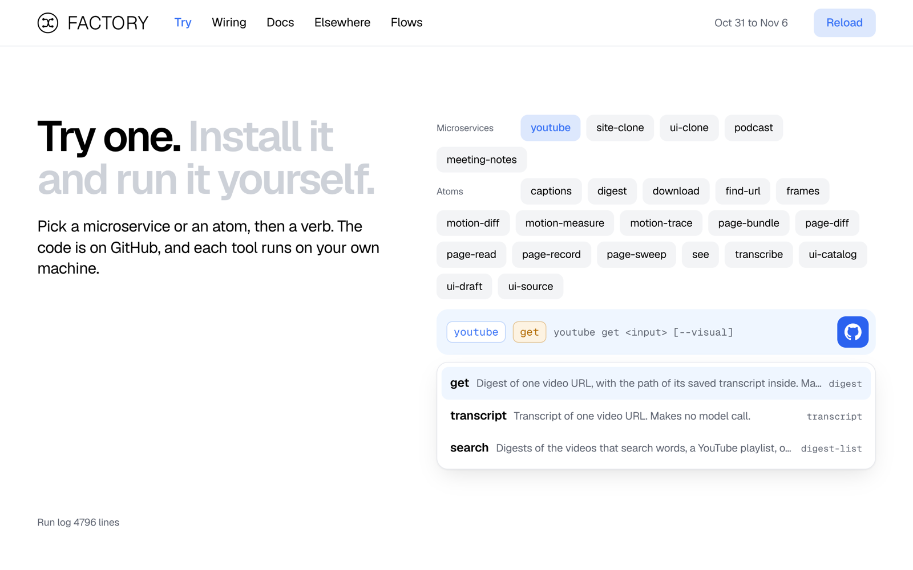
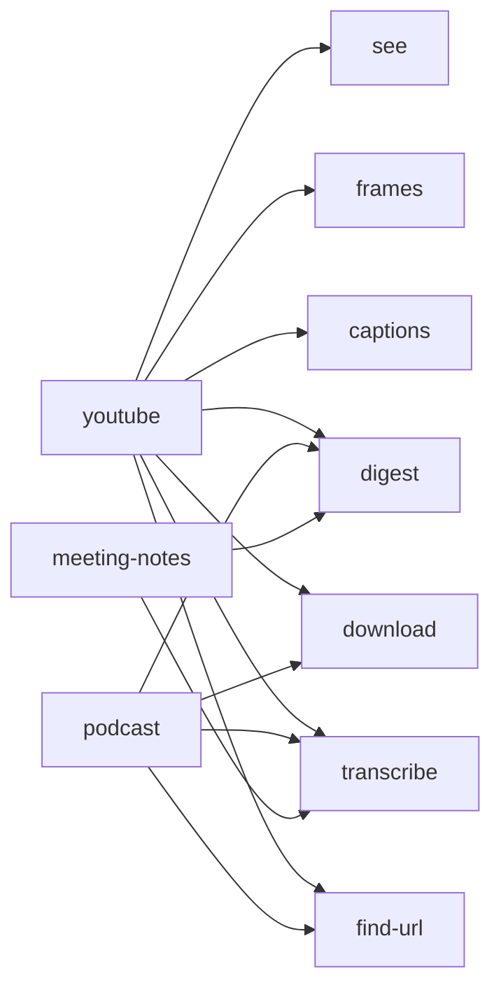
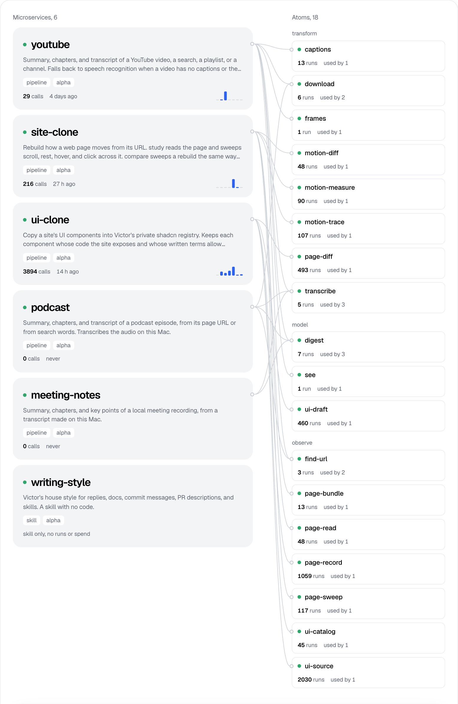

<div align="center">


# tool-factory

**Small command-line tools built from reusable parts, and one CLI that runs, tests, and wires them all.**

[](LICENSE)    

[Live dashboard](https://factory.victorz.studio) · [Quick start](#try-it-in-five-minutes) · [What's inside](#whats-inside) · [Architecture](ARCHITECTURE.md) · [Contributing](CONTRIBUTING.md)

<br>

<picture>
  <source media="(prefers-color-scheme: dark)" srcset="docs/media/try-dark.png">
  
</picture>

</div>

## One command, a real result

`youtube get` takes a video URL and prints a summary, chapters, and key points. It reads the site's captions, and it falls back to local speech recognition when a video has none.

```console
$ youtube get "https://www.youtube.com/watch?v=jNQXAC9IVRw"
The speaker stands in front of the elephants and says the cool thing about them is their really, really long trunks. An elephant sound interrupts near the end, and the speaker then says that's pretty much all there is to say.

Chapters
  0:01  In front of the elephants
  0:14  Elephant sound and wrap-up

Key points
  - The speaker is in front of the elephants.
  - The speaker says the cool thing about elephants is their really, really long trunks.
  - An elephant sound is heard around the 14-second mark.
  - The speaker ends by saying that's pretty much all there is to say.

Transcript: ~/.local/share/tool-factory/youtube/transcripts/82087ee0d9470d2d57f04e5e51443889.json
```

That run took 4 seconds and cost $0.0073. A second run reads the cache and costs nothing.

## Microservices are made of atoms

A **microservice** does one job you recognize. An **atom** owns one noun and returns one JSON shape. Microservices call atoms only through their CLIs, so a new tool often needs no new atom code. `meeting-notes` is `transcribe` plus `digest`.



Every tool has a `manifest.json`, a `SKILL.md`, and tests. The manifest is the single source of truth. The factory reads it to build the MCP tools, the dashboard rows, and the docs for each verb, so you never write a schema twice.

## Try it in five minutes

The repo runs on macOS, the only platform it has been tested on. You need [Node 24](https://nodejs.org) and [uv](https://docs.astral.sh/uv/). Each Python tool declares its own dependencies, and `uv` installs them on the first run.

1. Clone the repo.

   ```bash
   git clone https://github.com/V1ctor2182/tool-factory.git && cd tool-factory
   ```

2. Check that your machine has what each tool needs.

   ```bash
   node factory/bin/factory.mjs doctor
   ```

3. Get a transcript. This command makes no model call and costs nothing.

   ```bash
   node factory/bin/factory.mjs run youtube transcript "https://www.youtube.com/watch?v=jNQXAC9IVRw"
   ```

4. Open the dashboard at <http://127.0.0.1:4100> and try any verb from the page.

   ```bash
   node factory/bin/factory.mjs dashboard
   ```

Some tools need more. `doctor` reports each missing binary it knows about.

| Tool | Also needs | Why |
|---|---|---|
| `digest`, `see`, `ui-draft`, and the verbs that call them | [Claude Code](https://claude.com/claude-code), signed in | These atoms call the model through `claude -p`. Each call costs money, and the run log records the cost. |
| `frames`, `youtube get --visual` | `ffmpeg` | `frames` picks key frames from a video. |
| `page-read`, `page-sweep`, `site-clone` | Google Chrome | These tools read and record live pages. |
| `transcribe` | A one-time model download | whisper.cpp fetches its model on first use. |

## Plug a tool in where you work

`factory link` makes symlinks, so an edit applies on the next call. The MCP server starts the CLI fresh for each call.

| Caller | Command |
|---|---|
| Your shell, through `~/.local/bin` | `node factory/bin/factory.mjs link youtube --bin` |
| Every Claude Code session | `node factory/bin/factory.mjs link youtube --global` |
| One project's agent | `node factory/bin/factory.mjs link youtube --into ~/my-project` |
| An MCP client | `claude mcp add youtube -- node "$PWD/factory/bin/factory.mjs" mcp youtube` |

Every CLI follows one contract. `<name> <verb> [args] --json` writes one JSON object to stdout and logs to stderr. It exits 0 or 1, and it reports a failure as `{"error": {"code", "message"}}`.

## What's inside

Run `node factory/bin/factory.mjs list` for the live list.

### Microservices

| Name | What it does | Atoms it calls |
|---|---|---|
| [`youtube`](microservices/youtube) | Summarizes a video, a search, a playlist, or a channel, with optional notes on what appears on screen. | `find-url` `captions` `download` `transcribe` `frames` `see` `digest` |
| [`podcast`](microservices/podcast) | Summarizes an episode from its page URL or from search words, and transcribes the audio locally. | `find-url` `download` `transcribe` `digest` |
| [`meeting-notes`](microservices/meeting-notes) | Summarizes a local meeting recording. | `transcribe` `digest` |
| [`site-clone`](microservices/site-clone) | Studies how a web page moves, then lists how a rebuild still differs from it. | `page-bundle` `page-read` `page-sweep` `motion-measure` `motion-trace` `motion-diff` |
| [`ui-clone`](microservices/ui-clone) | Copies a site's shadcn components into a local registry when the site's written terms allow it, and rebuilds the rest from how they look and move. You supply the registry repo. | `ui-catalog` `ui-source` `page-record` `page-diff` `ui-draft` |
| [`writing-style`](microservices/writing-style) | A house style for prose. A skill with no code. | None |

### Atoms

An atom's `kind` decides how the factory caches, tests, and guards it.

| Kind | Cached | Tests assert | Cost | Atoms |
|---|---|---|---|---|
| `transform` | By content | A literal expected output | Free | `captions` `download` `frames` `transcribe` `motion-diff` `motion-measure` `motion-trace` `page-diff` |
| `model` | By input, model, and prompt hash | The schema plus required facts | Logged per call | `digest` `see` `ui-draft` |
| `observe` | Never | The schema, on a recorded fixture | Free | `find-url` `page-bundle` `page-read` `page-record` `page-sweep` `ui-catalog` `ui-source` |
| `act` | Never | A dry run returns the planned action | Varies | None yet. A hook requires confirmation on every run. |

Each atom's folder has a `SKILL.md` that documents it. The dashboard's Docs page documents every verb, its arguments, and its response.

## See everything in one place

`factory dashboard` serves a local status page with six views.

- **Home** shows health, failures, and spend.
- **Try** runs any verb from a form built from its manifest.
- **Wiring** shows which atoms each microservice calls.
- **Docs** is an API reference for every verb.
- **Elsewhere** lists tools that live in other repos.
- **Flows** draws agent pipelines as stages, loops, and timed traces.

<picture>
  <source media="(prefers-color-scheme: dark)" srcset="docs/media/wiring-dark.png">
  
</picture>

The [public copy](https://factory.victorz.studio) shows my real run log. It runs nothing, and its Try page links to GitHub instead. A [publish guard](factory/lib/public-flows.mjs) keeps paths and spend on my laptop.

## Where your data goes

- **Runtime data stays out of the repo.** Output, caches, and the run log live under `$TOOL_FACTORY_HOME`, which defaults to `~/.local/share/tool-factory/`.
- **Secrets come from the environment or the macOS keychain.** The repo holds no key files.
- **The dashboard binds to `127.0.0.1`.** It answers a run only when the request comes from its own page.
- **Nothing reaches a public site unless you send it.** `factory push` is a separate command, and it runs only when you call it.

## Who this is for

I built this for one person on one Mac, and the design says so. Manifests have no versions, and an output can change whenever I change its callers. Fork it, copy the parts you like, or read [ARCHITECTURE.md](ARCHITECTURE.md) for the rules and the reasons behind them. Expect breaking changes if you track `main`.

These tools download and copy from other people's sites. You are responsible for following each site's terms and the law where you live.

## License

[MIT](LICENSE)
